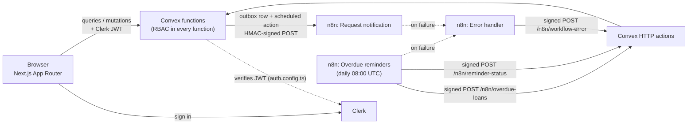

# LendLoop

Borrow what you need. Lend what you don't.

A neighborhood tool-lending board: neighbors list tools, request to borrow them for a date range, and the lender
approves, declines and marks them returned. n8n sends the notifications and the daily overdue reminders, and writes
what it did back to Convex.

Stack: Next.js 16 (App Router) + TypeScript, Clerk, Convex, n8n.

## Contents

- [Run it locally](#run-it-locally)
- [Environment variables](#environment-variables)
- [Architecture](#architecture)
- [Roles and access control](#roles-and-access-control)
- [Security and data minimization](#security-and-data-minimization)
- [Reliability of the n8n integration](#reliability-of-the-n8n-integration)
- [Tests](#tests)
- [What I'd change for production](#what-id-change-for-production)

## Run it locally

You need Node 20.9+ (I used 22) and Docker for n8n.

### 1. App and Convex

```bash
npm install
npx convex dev            # pick "local deployment"; writes NEXT_PUBLIC_CONVEX_URL etc. to .env.local
```

No Convex account is needed: a local deployment runs the open-source backend on `127.0.0.1:3210` (functions) and
`127.0.0.1:3211` (HTTP actions). In a non-interactive shell, `CONVEX_AGENT_MODE=anonymous npx convex dev` does the same.

### 2. Clerk

1. Get keys, either from a Clerk application (Dashboard → API keys) or as temporary accountless keys with
   `npx clerk@4.2.0 init --accountless` run in a scratch folder. Put `NEXT_PUBLIC_CLERK_PUBLISHABLE_KEY` and
   `CLERK_SECRET_KEY` in `.env.local`.
2. Let Convex verify Clerk's tokens. In the Clerk Dashboard, enable the **Convex integration** (Integrations →
   Convex). It creates a JWT template named `convex` with `aud: "convex"` and the standard claims (`name`,
   `given_name`, `email`, `email_verified`, ...). If you create the template by hand, use that name and include those
   claims; the app reads `given_name`/`name`, `email` and `email_verified`.
3. Tell Convex which issuer to trust (the Frontend API URL of your Clerk instance) and who the admins are:

```bash
npx convex env set CLERK_JWT_ISSUER_DOMAIN https://<your-instance>.clerk.accounts.dev
npx convex env set ADMIN_EMAILS you@example.com        # comma separated; only verified emails count
```

### 3. Run

```bash
npm run dev               # http://localhost:3000, keep `npx convex dev` running next to it
npx convex run seed:demo  # optional: demo tools and one overdue loan (an internal function, not callable from clients)
```

### 4. n8n

```bash
cp n8n/.env.example n8n/.env      # fill in the secrets: openssl rand -hex 32
docker compose up -d
docker compose exec n8n n8n import:workflow --separate --input=/workflows
```

Then open http://localhost:5678, create the owner account, and:

1. Check that *Settings → Error workflow* of **LendLoop - Request notification** and **LendLoop - Overdue reminders**
   points to **LendLoop - Error handler** (the import keeps the ids, so it should), then publish all three. In n8n 2.x
   the error handler must be published too, otherwise n8n refuses to run it. From the command line:

```bash
for id in LLnotifyWorkflow LLremindWorkflow LLerrorsWorkflow; do docker compose exec n8n n8n publish:workflow --id=$id; done
docker compose restart n8n
```

2. Give Convex the matching values:

```bash
npx convex env set N8N_WEBHOOK_URL http://localhost:5678/webhook/lendloop-loan-events
npx convex env set N8N_WEBHOOK_SECRET <same as LENDLOOP_WEBHOOK_SECRET in n8n/.env>
npx convex env set N8N_INBOUND_SECRET <same as LENDLOOP_INBOUND_SECRET in n8n/.env>
```

To try it: request a tool in the app and watch the n8n log (`docker compose logs -f n8n`) for the mock notification;
run the overdue workflow by hand (its *Run now* trigger, or `n8n execute --id LLremindWorkflow`) after `seed:demo` and the loan card shows "Reminder sent just
now". Everything n8n did, or failed to do, is in the app under **Admin → Automation log**.

No secret lives in the workflow JSON: the Code nodes read `$env.LENDLOOP_*`, and the optional Clerk/SMTP nodes take
n8n credentials you create in the UI. With a Convex cloud deployment, set `LENDLOOP_CONVEX_SITE_URL` to
`https://<deployment>.convex.site`, and `N8N_WEBHOOK_URL` must be reachable from the internet.

## Environment variables

| Where | Name | What it is |
|---|---|---|
| `.env.local` (Next.js) | `NEXT_PUBLIC_CONVEX_URL` | Convex client URL (written by `npx convex dev`) |
| `.env.local` | `CONVEX_DEPLOYMENT` | Which deployment `npx convex` targets (written by `npx convex dev`) |
| `.env.local` | `NEXT_PUBLIC_CLERK_PUBLISHABLE_KEY`, `CLERK_SECRET_KEY` | Clerk keys |
| Convex deployment | `CLERK_JWT_ISSUER_DOMAIN` | Clerk Frontend API URL; Convex checks JWTs against its JWKS |
| Convex deployment | `ADMIN_EMAILS` | Comma-separated admin emails (must be verified in Clerk) |
| Convex deployment | `N8N_WEBHOOK_URL` | n8n webhook for loan events |
| Convex deployment | `N8N_WEBHOOK_SECRET` | HMAC secret, Convex → n8n |
| Convex deployment | `N8N_INBOUND_SECRET` | HMAC secret, n8n → Convex |
| `n8n/.env` | `N8N_ENCRYPTION_KEY` | Encrypts the credentials n8n stores |
| `n8n/.env` | `LENDLOOP_WEBHOOK_SECRET` | Same value as `N8N_WEBHOOK_SECRET` |
| `n8n/.env` | `LENDLOOP_INBOUND_SECRET` | Same value as `N8N_INBOUND_SECRET` |
| `n8n/.env` | `LENDLOOP_CONVEX_SITE_URL` | Convex HTTP actions URL (`http://host.docker.internal:3211` locally) |

`.env.example` and `n8n/.env.example` list them. `.env`, `.env*.local` and `n8n/.env` are git-ignored.

## Architecture



```
app/                    pages: / (public), (board)/tools, listings, requests, incoming, admin
components/             header, viewer gate, tool form, loan list, load-more, top loader
convex/
  schema.ts             users, tools, loans, automationEvents
  lib/auth.ts           getViewer / requireViewer / requireAdmin: the one auth helper every function uses
  lib/rules.ts          pure rules: date ranges, overlap, who may do what (unit tested)
  lib/hmac.ts           sign / verify / constant-time compare, shared by both directions
  tools.ts loans.ts users.ts   public queries and mutations
  notifications.ts      outbox → signed webhook → retries with backoff
  automation.ts         overdue page, idempotent write-backs, error reports, admin log
  http.ts               the three signed endpoints n8n calls
n8n/workflows/          exported workflows (no secrets)
docker-compose.yml      n8n
tests/                  vitest: unit rules + Convex functions with convex-test
```

Data model, in short: `loans` stores `toolName` and the owner and borrower ids so the request views need no joins
and keep making sense after a listing is removed (listings are soft-deleted). `automationEvents` is both the outbox
for notifications and the audit log of everything that crossed the n8n boundary, keyed by an idempotency key.
Every list in the UI is paginated with `.paginate()` over an index and a "Load more" button.

## Roles and access control

Checks happen in Convex, inside each function. The UI hides buttons, `proxy.ts` + `auth.protect()` keep signed-out
visitors out of the board pages, but neither is the security boundary.

- **Identity** comes from the Clerk JWT that Convex has verified. `requireViewer(ctx)` maps it to our `users` row;
  `requireAdmin(ctx)` also checks the role. Every public query and mutation starts with one of them, except
  `tools.listPublic`, which is deliberately anonymous.
- **Role** lives in our database and is set on sign-in from `ADMIN_EMAILS`, only when Clerk says the email is
  verified. The client never sends a role. (Clerk `publicMetadata.role` in the JWT would work too; I kept the allow
  list because it is one env var and easy to audit.)
- **Ownership**: only the owner edits or deletes a listing; only the lender approves, declines or marks returned; only
  the borrower cancels a pending request. `lib/rules.ts` holds these rules as one table of transitions, so "who can
  move a loan from which status" is in one place and tested.
- **Admins** can remove any listing, see all loans, see the automation log and mark members as Trusted Lender. They
  cannot edit another member's listing or approve loans for them: moderation, not impersonation.
- Request rules: no borrowing your own tool, valid dates, not in the past (one day of slack for time zones), at most
  30 days, and no overlap with an approved loan. Approval re-checks the overlap, because two pending requests can
  cover the same days.

## Security and data minimization

**Both directions are signed.** HMAC-SHA256 over `"<unix timestamp>.<raw body>"`, sent as `x-lendloop-timestamp`
and `x-lendloop-signature: sha256=<hex>` (the Stripe/Slack scheme). The receiver recomputes it over the raw bytes,
compares in constant time, and rejects anything older or newer than 5 minutes. Each direction has its own secret, so
a leaked n8n secret cannot be used to forge events into n8n and the other way around. Rejections return a bare 401;
the reason only goes to the server log.

**Secrets** are only in env vars (Convex deployment env, `n8n/.env`) and n8n credentials. The exported workflows
reference `$env.LENDLOOP_*`. To let Code nodes read them, `docker-compose.yml` sets
`N8N_BLOCK_ENV_ACCESS_IN_NODE=false`; that is a trade-off I note under production changes.

**Inbound endpoints are narrow.** Three POST routes, each validating its body by hand; `asOf` must be yesterday,
today or tomorrow (UTC), so even a valid signed request cannot backfill reminders for arbitrary days.

**Data minimization:**

- Public page: the query returns `_id`, `name` and `category` and nothing else (a test checks the exact keys).
- Convex never stores emails. The email is read from the JWT once, on sign-in, to decide the admin role. Users have
  a first name, a role and a trusted flag.
- The notification webhook carries one recipient's first name and opaque Clerk user id, the tool name and the dates.
  No emails, no phone numbers, no description, and not both parties' identities. The overdue endpoint returns the same
  shape. Tests assert there is no `@` in either payload.
- Real email is optional and off by default: two disabled nodes look up the address in Clerk with a scoped key at send
  time and send it over SMTP. The address goes Clerk → n8n → SMTP and never through Convex or the webhook.
- The error workflow reports workflow name, node name, execution id and the error message (truncated), not item data.
- Client error messages are the server's own rule messages (`ConvexError`); anything unexpected becomes a generic line.

## Reliability of the n8n integration

| Concern | What I did |
|---|---|
| A status change without a notification | Transactional outbox: the loan update, the `automationEvents` row and the scheduled delivery commit in one Convex mutation, or none of them do. |
| n8n down or slow | The delivery action has a 10 s timeout and retries with backoff (30 s, 1, 2, 4 min; 5 attempts). Then the event is marked `failed` with the reason. |
| Duplicate notifications | One event per `notify:<loanId>:<status>`. Convex sends that key as `eventId`; n8n's Remove Duplicates node drops an event it has already processed (e.g. a timeout after n8n had answered). |
| Duplicate reminders | Write-backs are keyed `reminder:<loanId>:<asOf>`, so n8n retries land on the same row. A later `sent` can upgrade a `failed`, never the other way. The overdue endpoint skips loans already reminded that day, so re-running the workflow does not remind anyone twice. |
| Transient HTTP errors in n8n | `retryOnFail` (3 tries, 5 s apart) on every HTTP node. Safe because every write-back is idempotent. |
| One bad loan breaking the run | The reminder node continues on error; that loan is written back as `failed` and the rest go on. |
| Many overdue loans | The endpoint is paginated (50 per page) and the workflow loops on the cursor until `isDone`. |
| Silent failures | Both workflows name the error workflow. It logs the failure, keeps the execution in n8n (error executions are always saved) and reports it to `POST /n8n/workflow-error`, idempotent per execution id. Admin → Automation log lists everything, with an "only failures" filter. |
| Seeing it per loan | Each loan stores its last automation event, so the cards say "Reminder sent 2 days ago" or "Notification failed 5 minutes ago". |

The webhook answers 202 before sending the notification, so the app's request never waits on the channel. The
cost is that a failure after the 202 is n8n's to report, which is what the error workflow is for.

## Tests

```bash
npm test          # vitest: 24 tests
npm run typecheck
npm run lint
npm run build
```

- `tests/unit.test.ts`: HMAC sign/verify (tampered body, wrong secret, missing headers, replay window, timestamp
  binding), constant-time compare, date overlap and range validation, the RBAC rules and the admin role.
- `tests/convex.test.ts`: the real Convex functions on `convex-test`: users cannot touch other people's listings or
  loans, admins cannot edit or approve for others, admin-only queries reject users and anonymous callers, the public
  list exposes only name and category, overlap is rejected at request and at approval, signed endpoints reject
  unsigned / wrong-secret / stale calls, reminder write-backs are idempotent, error reports dedupe, and the webhook is
  signed and retried until n8n accepts it.

I also ran the whole chain once against the local Convex backend and n8n 2.48.4 (run with `npx`, as Docker was not
available on the machine I built this on, so `docker-compose.yml` itself is untested):

- the three workflow files import with their ids;
- a borrow request reached the n8n webhook signed and the event was marked `sent`; the webhook answered 401 to a
  wrong secret and to a stale timestamp;
- the overdue workflow fetched the seeded overdue loan, logged the reminder and wrote `sent` back; a second run found
  nothing to do;
- a malformed event made the notification workflow fail, and the error handler reported it to Convex, where it shows
  in the automation log as `n8n-error:<execution id>`.

## What I'd change for production

- **Secrets in n8n**: use n8n external secrets (Vault, AWS Secrets Manager) instead of env access from Code nodes, and
  turn `N8N_BLOCK_ENV_ACCESS_IN_NODE` back on. Rotate secrets with a short overlap window (accept two keys).
- **n8n hosting**: queue mode with Postgres and Redis instead of SQLite, behind TLS, with the webhook path on its own
  host and IP allow-listing or mTLS from Convex. Alert on the error workflow (Slack/PagerDuty), not just log it.
- **Auth**: Clerk production instance, roles through Clerk organizations or `publicMetadata` managed by an admin
  screen, and a Clerk webhook to remove our user row when a Clerk user is deleted.
- **Rate limits** on mutations (request spam) and on the HTTP endpoints, e.g. with the Convex rate-limiter component.
- **Time zones**: dates are UTC calendar days. I would store each neighborhood's time zone and compute "today" and
  overdue in it.
- **Notifications**: a real channel (email or push), user preferences and opt-out, and templates outside the workflow.
- **Data lifecycle**: retention for `automationEvents` and n8n execution data, and an export/delete path per user.
- **Observability**: structured logs and metrics on delivery latency and failure rate; a dead-letter view with a
  "retry now" button for failed events.
- **CI**: run lint, typecheck, tests and build on every push, and a smoke test that imports the workflows into a
  disposable n8n.
